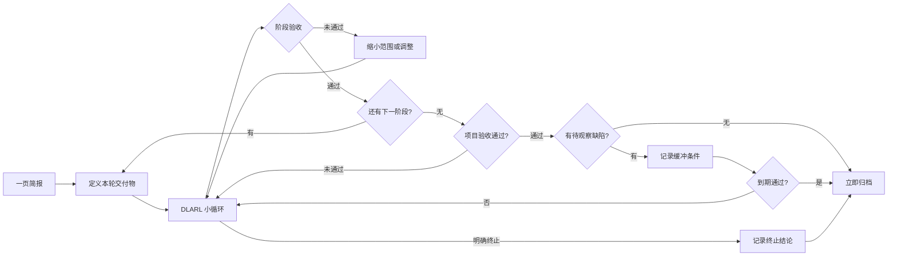

# 项目 SOP

---
用途：在立项、阶段切换、验收和归档时提供最小操作规范
更新频率：随项目经验按需更新
定位：按里程碑使用，不是日常入口
---

## 一、轻量立项门

恢复期只允许 1 个 P0。开始前先写一页项目简报，不因资料不全阻断行动。

```markdown
# 项目简报
- 类型：商业 / 作品 / 纯学习 / 课程
- 用户/问题：一个具体用户正在遇到什么问题？
- 可见交付物：本轮结束时能看到、运行或展示什么？
- 截止日期：YYYY-MM-DD
- 15 分钟内第一步：一个现在就能完成的动作
- 本轮验收标准：满足哪些可观察条件才算完成？
- 主要约束：时间、技术、资源或合规限制
```

立项只检查以下四项：

- [ ] 写清一个用户/问题。
- [ ] 写清一个可见交付物。
- [ ] 写清一个截止日期。
- [ ] 写清一个 15 分钟内第一步。

纯学习或课程项目只需标注类型。以下变现三问可选，不阻断立项：谁需要、现在如何解决、可能如何收费。

先用一页简报启动；强工程证据不作为轻量立项前置条件。需要 PRD、ADR、Prompt 版本、工程检查或开源发布证据时，按需查阅后台手册 [[AI项目开发参考手册|AI项目开发参考手册]]。

选路规则：默认走本 SOP 的轻量路径；项目高风险、决策不可逆、涉及外部发布或安全合规时，进入后台手册的完整工程路径。

## 二、项目生命周期



项目以可见交付物推进。阶段过大时拆小；约束变化时更新简报，不重新走复杂审批。

## 三、最小 DLARL 循环

每轮只围绕一个可验证结果执行：

1. **Design**：写清本轮交付物、约束和验收标准。
2. **AI 落地**：一次只实现一个可验证步骤。
3. **Review**：先运行和检查，再判断是否接受 AI 产出。
4. **Learn**：只补当前交付物所需的知识，默认限时 15 分钟。
5. **Adjust**：记录一个改变，下轮继续验证。

PRD、ADR 和架构深度随风险缩放：低风险改动用简短记录，高风险或不可逆决策再增加证据。两周学习成果不强制齐全，能支撑当前交付物即可。

接受 AI 产出前，至少确认：它已运行或被实际检查；结果满足本轮验收；关键行为能够解释；失败时知道如何回退或继续定位。

## 四、可选分步 MVP

适合软件项目的默认顺序：

`可运行骨架 -> 数据/状态 -> 核心规则 -> 外部或 AI 集成 -> 界面 -> 日志与发布`

这不是强制模板。若采用，每阶段必须有可观察验收，验收通过才进入下一阶段。

| 阶段 | 可观察验收示例 |
|---|---|
| 可运行骨架 | 能启动，并能看到一次成功响应或页面 |
| 数据/状态 | 能写入、读取并验证一条真实状态变化 |
| 核心规则 | 关键输入产生预期输出，边界情况可复现 |
| 外部或 AI 集成 | 真实调用成功，失败状态可见且可处理 |
| 界面 | 核心流程可由目标用户完成 |
| 日志与发布 | 关键事件可追踪，目标环境可运行或交付 |

若某阶段与交付物无关，记录跳过原因即可。

## 五、每轮结果检查

进展只按结果判断。每轮结束只回答：

- [ ] 是否可运行或展示？
- [ ] 是否满足本轮验收？
- [ ] 能否解释接受的 AI 部分？
- [ ] 最小下一步是什么？

如果前两项未通过，先缩小范围或修复阻断问题；不要用新增文档、学习时长或活动数量代替结果。

没有可靠数据时标记为“未知”或“不适用”，不得编造覆盖率、性能、成本、完成率、用户反馈等指标。

## 六、项目验收

项目完成以立项简报中的交付物为准，并做最终检查：

- [ ] 目标用户能够看到、运行或使用交付物。
- [ ] 核心流程满足约定的验收标准。
- [ ] 运行方式、必要依赖和已知限制可被下一位使用者理解。
- [ ] 高风险决策、外部集成和 AI 产出已有与风险相称的验证证据。
- [ ] 未完成项已明确删除、延期或转入下一项目，不保持模糊状态。

验收失败时，记录失败现象和一个最小修复步骤，回到 DLARL 循环。需要更强的 PRD、ADR、Prompt 版本、工程检查或开源发布清单时，查阅 [[AI项目开发参考手册|AI项目开发参考手册]]。

## 七、暂停与归档

### 暂停

项目失去优先级、依赖长期阻塞或交付物不再有价值时，写明：当前状态、已验证结果、阻塞原因、恢复条件和恢复后的第一步。暂停不是失败，也不保留隐性承诺。

### 归档

验收通过或明确终止后归档：

- [ ] 保留一页项目简报和最终验收结论。
- [ ] 记录交付物位置、运行方式和必要权限。
- [ ] 记录一个有效经验、一个无效假设和一个后续建议。
- [ ] 将未完成事项明确删除或迁移，不复制模糊待办。

无待观察缺陷时立即归档。确需缓冲时，记录每个缺陷、负责人、最晚日期和通过条件；到期满足条件则归档，未满足则回到 DLARL 循环，不得以缓冲代替验收。

归档的目的，是让未来的人能快速判断项目做了什么、结果在哪里、是否值得恢复，而不是补齐所有过程材料。

## 八、执行原则

> 先交付一个可验证结果，再扩大范围。

- 一次只推进当前最高优先级的可见交付物。
- 学习服务于交付，当前用不到的知识进入资源库而非当前计划。
- AI 可以加速生成，接受责任仍属于执行者。
- 文档和工程证据按风险增加，不把流程本身当作成果。
